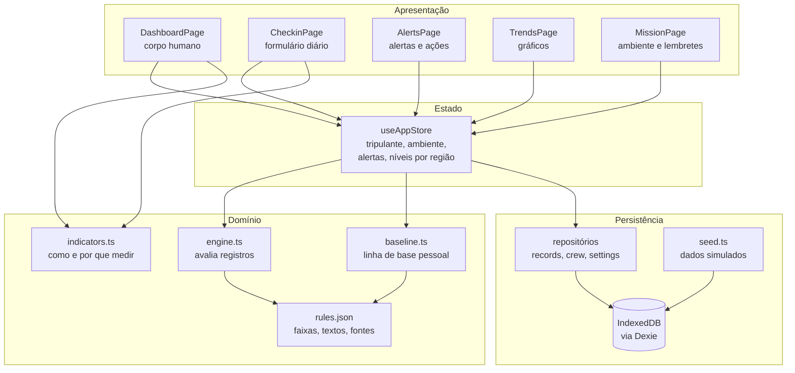

# Diagrama 1: visão geral dos componentes

Mostra as quatro camadas do app e quem chama quem. Tudo roda dentro do navegador; não há servidor.

## Como ler

- As páginas só falam com o store e com os textos de `content/`.
- O store é o único ponto que junta dados, linha de base e motor de regras.
- O motor de regras não conhece banco nem interface. Recebe dados e devolve alertas.
- `rules.json` é a única fonte de faixas e textos de alerta.
