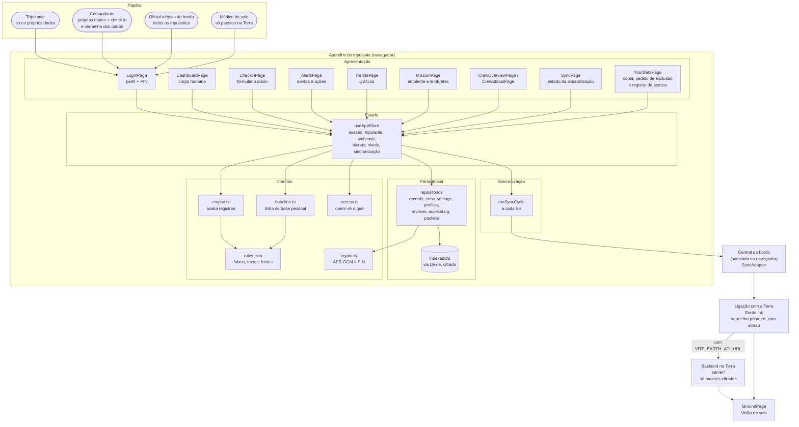

# Diagrama 1: visão geral dos componentes

Mostra as camadas do app, a central de bordo, a Terra e quem chama quem. O app roda inteiro no navegador. O único servidor é o backend na Terra, que só guarda pacotes cifrados; a nave nunca depende dele.

## Como ler

- Todos os papéis entram pela mesma tela, com perfil e PIN. O papel decide as telas.
- As páginas só falam com o store e com os textos de `content/`.
- O store é o único ponto que junta sessão, dados, linha de base, motor de regras e sincronização.
- O motor de regras não conhece banco nem interface. Recebe dados e devolve alertas.
- Os repositórios cifram e decifram. Nada de saúde fica aberto no IndexedDB.
- O alerta sai no aparelho, na hora. A central e a Terra recebem depois.
- Sem `VITE_EARTH_API_URL`, a ligação com a Terra é simulada no navegador. Com ele, os pacotes vão ao backend.
- O médico do solo só vê pacotes que chegaram, depois do atraso do ambiente.
