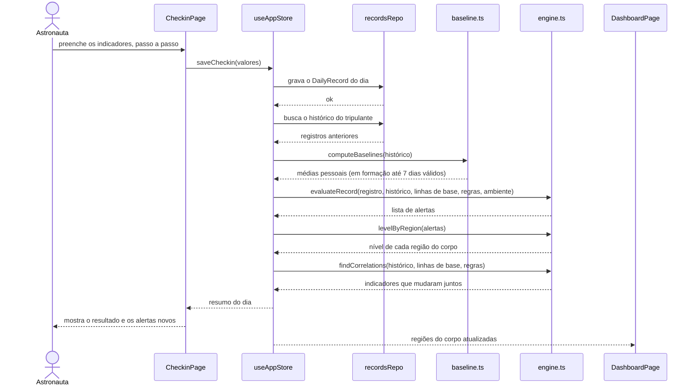

# Diagrama 2: fluxo do check-in diário

Mostra o que acontece desde que o astronauta salva o check-in até o painel mudar de cor.

## Pontos importantes

- Existe um registro por tripulante por dia. Salvar de novo no mesmo dia substitui o anterior.
- A linha de base é recalculada do histórico, mas só usa os primeiros `baselineDays` dias válidos, então para de mudar quando fica pronta. Dias fora da faixa geral não entram no cálculo.
- O check-in só pede os indicadores da lista `trackedIndicators` do tripulante.
- Os alertas não são gravados no banco. São recalculados a cada check-in e a cada abertura do app.
- Nenhum passo usa rede.
