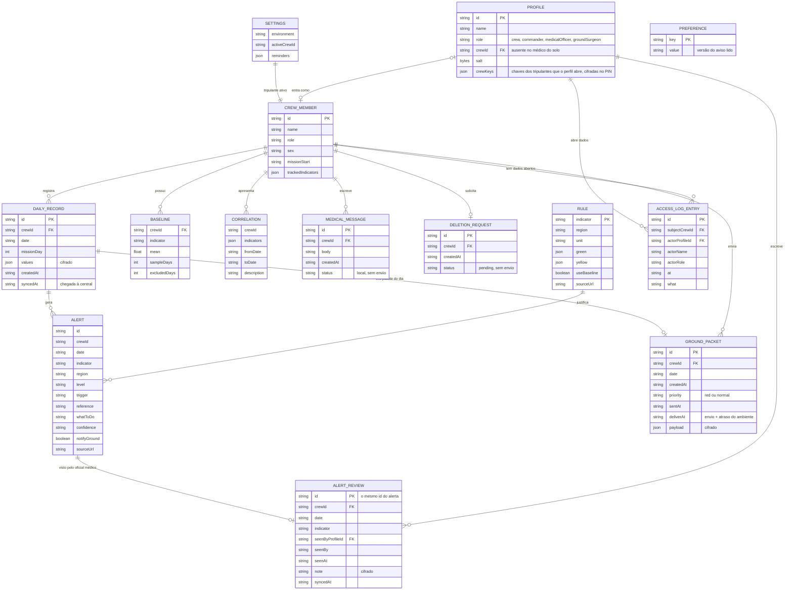

# Diagrama 3: modelo de dados

Mostra as entidades e como se relacionam. Os tipos completos estão em `docs/arquitetura.md`.

## Onde cada entidade vive

| Entidade | Onde fica | Observação |
| --- | --- | --- |
| `CREW_MEMBER` | IndexedDB, tabela `crew` | Três tripulantes fictícios vindos do `seed.ts` |
| `DAILY_RECORD` | IndexedDB, tabela `records` | Um por tripulante por dia. `values` cifrado; `syncedAt` marca a chegada à central |
| `PROFILE` | IndexedDB, tabela `profiles` | Quatro perfis na demo. Guarda, cifradas no PIN, só as chaves que o perfil pode abrir; o PIN não é gravado |
| `ALERT_REVIEW` | IndexedDB, tabela `reviews` | Alerta visto pelo oficial médico. A conduta (`note`) fica cifrada |
| `ACCESS_LOG_ENTRY` | IndexedDB, tabela `accessLog` | Quem abriu os dados de quem. O tripulante vê em "Seus dados" |
| `GROUND_PACKET` | IndexedDB, tabela `packets`; cópia no backend da Terra | Um por tripulante por dia. `payload` cifrado; o servidor guarda sem abrir |
| `BASELINE` | Só em memória, no store | Recalculada a partir dos registros; uma por tripulante por série numérica |
| `SETTINGS` | IndexedDB, tabela `settings` | Registro único |
| `RULE` | Arquivo `src/rules/rules.json` | Não vai para o banco |
| `ALERT` | Só em memória, no store | Recalculado a partir dos registros |
| `CORRELATION` | Só em memória, no store | Recalculada junto com os alertas; não muda nível |
| `Session` | Só em memória, no store | Quem entrou. Some ao bloquear ou recarregar, junto com a chave |
| `MEDICAL_MESSAGE` | IndexedDB, tabela `medicalMessages` | Texto cifrado por perfil, sem entrega |
| `DELETION_REQUEST` | IndexedDB, tabela `deletionRequests` | Uma solicitação local por perfil |
| `PREFERENCE` | IndexedDB, tabela `preferences` | Leitura versionada do aviso; preservada no reset |

Ficam abertos no banco só os metadados usados para buscar e para a fila: ids, tripulante, datas e prioridade.
