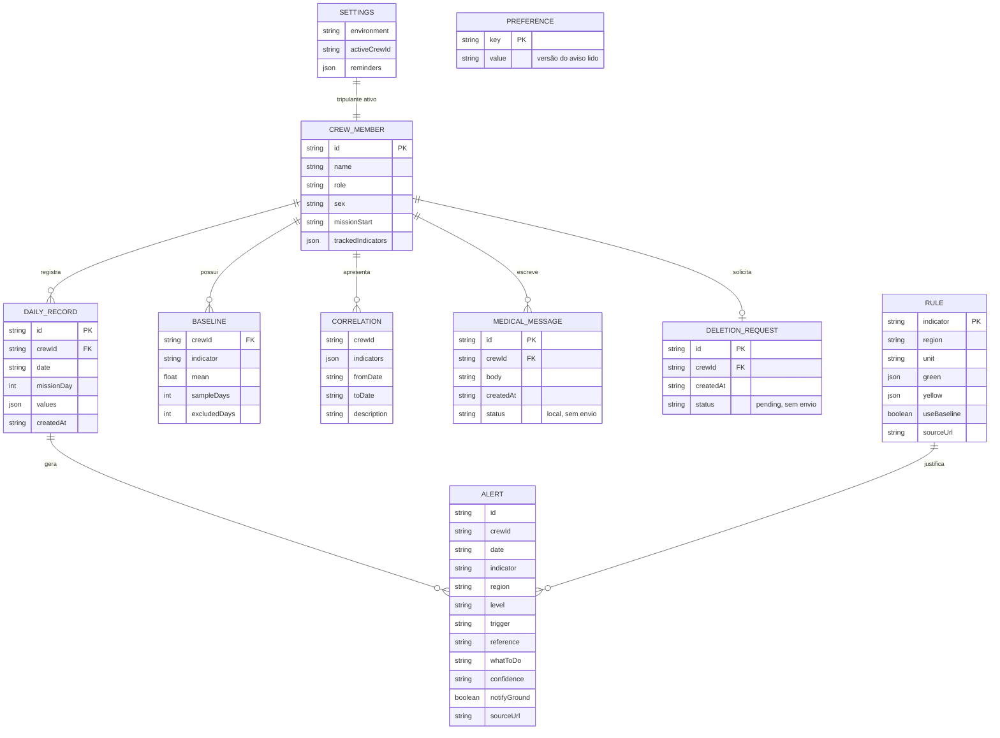

# Diagrama 3: modelo de dados

Mostra as entidades e como se relacionam. Os tipos completos estão em `docs/arquitetura.md`.

## Onde cada entidade vive

| Entidade | Onde fica | Observação |
| --- | --- | --- |
| `CREW_MEMBER` | IndexedDB, tabela `crew` | Três tripulantes fictícios vindos do `seed.ts` |
| `DAILY_RECORD` | IndexedDB, tabela `records` | Um por tripulante por dia |
| `BASELINE` | Só em memória, no store | Recalculada a partir dos registros; uma por tripulante por série numérica |
| `SETTINGS` | IndexedDB, tabela `settings` | Registro único |
| `RULE` | Arquivo `src/rules/rules.json` | Não vai para o banco |
| `ALERT` | Só em memória, no store | Recalculado a partir dos registros |
| `CORRELATION` | Só em memória, no store | Recalculada junto com os alertas; não muda nível |
| `MEDICAL_MESSAGE` | IndexedDB, tabela `medicalMessages` | Texto por perfil, sem entrega |
| `DELETION_REQUEST` | IndexedDB, tabela `deletionRequests` | Uma solicitação local por perfil |
| `PREFERENCE` | IndexedDB, tabela `preferences` | Leitura versionada do aviso; preservada no reset |
