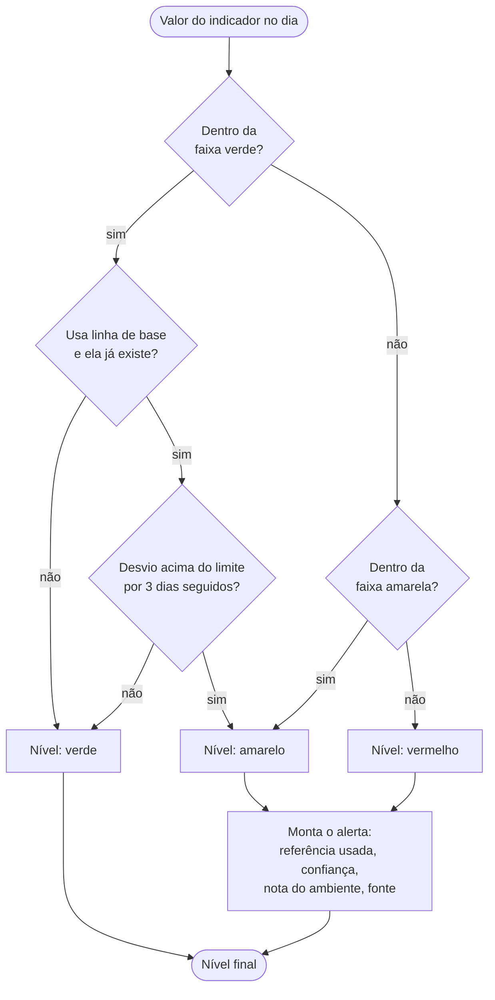
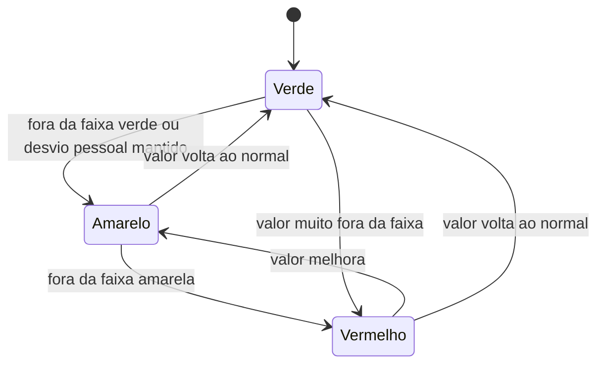

# Diagrama 4: níveis de alerta

Mostra como o motor de regras decide o nível de um indicador num dia.

## Decisão para um indicador

Os valores "3 dias" e o limite de desvio (15%) vêm de `config` em `rules.json` e são de demonstração.

O ambiente da missão não aparece na decisão. Ele só acrescenta uma nota de texto ao alerta.

A linha de base nunca melhora um nível: um valor fora da faixa geral é amarelo ou vermelho mesmo que seja comum para aquela pessoa.

## O que cada nível significa

| Nível | Significado | O que o app faz |
| --- | --- | --- |
| Verde | Dentro do esperado | Mostra o valor e a tendência |
| Amarelo | Merece acompanhamento | Cria alerta com ação sugerida e pede nova medida |
| Vermelho | Pede atenção imediata | Cria alerta, indica chamar o médico de bordo e marca aviso ao solo |

## Da regra ao corpo humano

Cada indicador pertence a uma região do corpo. A cor da região é o pior nível entre os indicadores dela.

| Região | Indicadores |
| --- | --- |
| `head` | `vision` |
| `heart` | `bloodPressure`, `heartRate` |
| `musculoskeletal` | `exerciseMinutes` |
| `immune` | `temperature` |
| `metabolism` | `glucose` |
| `mind` | `sleepHours`, `mood` |
| `wholeBody` | `radiationDose`, `symptoms` |
