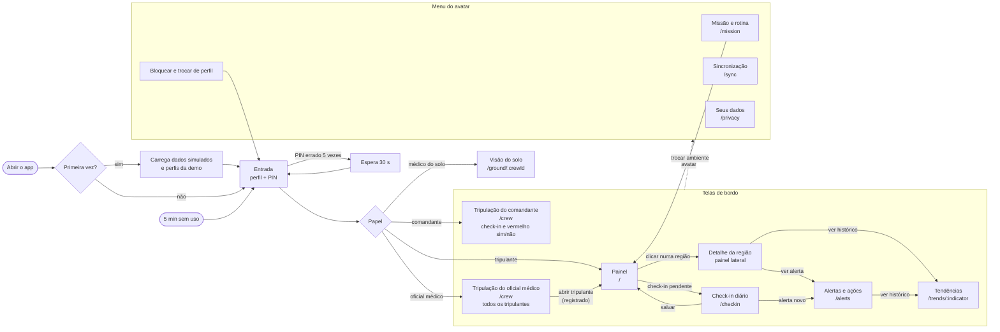

# Diagrama 5: navegação entre telas

Mostra a entrada, as telas de cada papel e os caminhos entre elas.

## Rotas

| Rota | Página | Quem vê | Prioridade |
| --- | --- | --- | --- |
| (sem sessão) | `LoginPage` | Todos | Essencial |
| `/` | `DashboardPage` | Bordo | Essencial |
| `/checkin` | `CheckinPage` | Bordo | Essencial |
| `/alerts` | `AlertsPage` | Bordo | Essencial |
| `/trends/:indicator` | `TrendsPage` | Bordo | Desejável |
| `/mission` | `MissionPage` | Bordo | Desejável |
| `/crew` | `CrewStatusPage` | Comandante | Essencial |
| `/crew` | `CrewOverviewPage` | Oficial médico | Essencial |
| `/sync` | `SyncPage` | Bordo | Desejável |
| `/privacy` | `PrivacyPage` | Quem é tripulante | Desejável |
| `/ground/:crewId` | `GroundPage` | Médico do solo | Essencial |

"Bordo" é tripulante, comandante e oficial médico. O médico do solo só tem `/ground`; qualquer outra rota volta para lá.

## Barra de navegação por papel

No máximo cinco links. No celular eles viram a barra de baixo.

| Papel | Links |
| --- | --- |
| Tripulante | Painel, Check-in, Alertas, Tendências, Missão |
| Comandante | Tripulação, Painel, Check-in, Alertas, Tendências |
| Oficial médico | Tripulação, Painel, Check-in, Alertas, Tendências |
| Médico do solo | Visão do solo |

## Elementos fixos em todas as telas

- Barra de navegação com os links do papel.
- Indicador do ambiente atual (estação, trânsito, Lua ou Marte), só a bordo.
- Seletor de tripulante, só para o oficial médico.
- Faixa "você está vendo os dados de...", quando o oficial médico vê outro tripulante.
- Menu do avatar com nome e papel; ponto quando há itens na fila de sincronização.
- Rodapé com o aviso de protótipo.

## Menu do avatar

- Missão e rotina (só a bordo).
- Sincronização, com quantos itens estão na fila (só a bordo).
- Seus dados (só quem é tripulante).
- Bloquear e trocar de perfil.

## Passos do check-in

O check-in mostra um indicador por passo, nesta ordem: pressão arterial, frequência cardíaca, temperatura, glicemia, sono, humor, exercício, radiação, visão, sintomas. Só aparecem os indicadores que o tripulante acompanha. Cada passo tem o campo de entrada, "como medir" e "por que medir". Qualquer passo pode ser pulado.

## O que a tela de alertas mostra em cada alerta

O que mudou, em relação a qual referência, por que importa, o que fazer, nota do ambiente, confiança do dado e fonte. Se o oficial médico já viu, aparece "visto pelo oficial médico" com a conduta. Abaixo dos alertas, uma seção "Mudaram juntos" lista as correlações, sem dizer que uma causou a outra.
