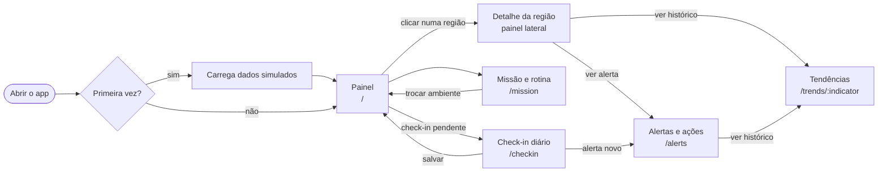

# Diagrama 5: navegação entre telas

Mostra as cinco telas e os caminhos entre elas.

## Rotas

| Rota | Página | Prioridade |
| --- | --- | --- |
| `/` | `DashboardPage` | Essencial |
| `/checkin` | `CheckinPage` | Essencial |
| `/alerts` | `AlertsPage` | Essencial |
| `/trends/:indicator` | `TrendsPage` | Desejável |
| `/mission` | `MissionPage` | Desejável |

## Elementos fixos em todas as telas

- Barra de navegação com as cinco telas.
- Seletor de tripulante.
- Indicador do ambiente atual (estação, trânsito, Lua ou Marte).
- Rodapé com o aviso de protótipo.

## Passos do check-in

O check-in mostra um indicador por passo, nesta ordem: pressão arterial, frequência cardíaca, temperatura, glicemia, sono, humor, exercício, radiação, visão, sintomas. Só aparecem os indicadores que o tripulante acompanha. Cada passo tem o campo de entrada, "como medir" e "por que medir". Qualquer passo pode ser pulado.

## O que a tela de alertas mostra em cada alerta

O que mudou, em relação a qual referência, por que importa, o que fazer, nota do ambiente, confiança do dado e fonte. Abaixo dos alertas, uma seção "Mudaram juntos" lista as correlações, sem dizer que uma causou a outra.
